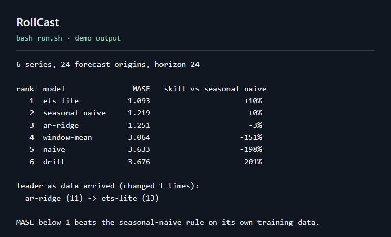
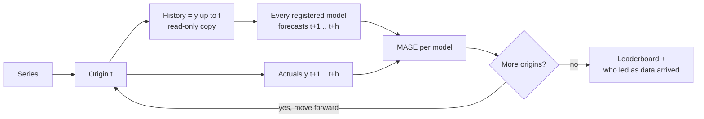

# RollCast

A rolling-origin forecasting benchmark with classical baselines and CSV support.

## Quickstart

On the historical AirPassengers series, ridge autoregression achieved **0.648 MASE** against **1.438** for seasonal naive across six annual forecast origins.

Replay forecast windows on a synthetic series panel and compare models using only past data.

```sh
uv sync --locked
uv run --locked rollcast demo
```

Run `bash run.sh` for checks followed by the demo.

[Rolling-origin evaluation](src/rollcast/backtest.py) · [Forecast isolation and score tests](tests/test_rollcast.py)

## Demo output

### Historical passenger demand

The bundled CSV contains 144 monthly observations of international airline passenger counts, in thousands, from January 1949 through December 1960. The first fit uses 1949–1954. Each subsequent origin adds a year of history and forecasts the following 12 months. The six test windows cover 1955–1960. [Data](examples/air-passengers.csv) · [R source series](https://github.com/wch/r-source/blob/trunk/src/library/datasets/data/AirPassengers.R)

```sh
uv run --locked rollcast run examples/air-passengers.csv --season 12 --horizon 12 --step 12 --start 0.5
```

| Model | Mean MASE |
| --- | ---: |
| Ridge autoregression | 0.648 |
| Seasonal naive | 1.438 |
| ETS-lite | 1.852 |
| Window mean | 1.885 |
| Drift | 1.994 |
| Naive | 2.316 |

Ridge led the cumulative leaderboard after each of the six origins. The small number of origins limits how precisely this run estimates its advantage.

### Synthetic panel demo



## Why rolling origins

A single train/test split gives you one number from one moment, and it is easy
to leak the future into it. A rolling-origin backtest repeats the exercise: at
each origin the model sees only data up to that point, forecasts the next
`horizon` steps, and is scored against what really happened. Then the origin
moves forward. That is what a live benchmark does, replayed on history.



Leakage is blocked structurally: models get a read-only slice, and a test
changes every value after the origin and checks that no forecast moves.

## Run it

```
6 series, 24 forecast origins, horizon 24

rank  model               MASE   skill vs seasonal-naive
   1  ets-lite           1.093                     +10%
   2  seasonal-naive     1.219                      +0%
   3  ar-ridge           1.251                      -3%
   4  window-mean        3.064                    -151%
   5  naive              3.633                    -198%
   6  drift              3.676                    -201%

leader as data arrived (changed 1 times):
  ar-ridge (11) -> ets-lite (13)
```

The last two lines are the point. Half the demo series have a level shift at
70% of the way through. A model that led for the first half of the run was
overtaken once the regime changed. A single full-sample score hides that.

**MASE** divides the model's error by the in-sample error of the
seasonal-naive rule, so 1.0 means "as good as repeating last season". It is
comparable across series with different scales.

## Your data

A CSV with one column per series and a header row:

```bash
uv run rollcast run sales.csv --horizon 24 --season 24 --step 12
```

## Add a model

```python
import numpy as np
from rollcast.models import register


@register("my-model")
def my_model(history: np.ndarray, horizon: int, season: int) -> np.ndarray:
    return np.full(horizon, history[-season:].mean())
```

The function gets a read-only history and must return `horizon` finite
numbers. Anything else raises an error instead of being scored. Wrapping a
foundation model such as Chronos or TimesFM would follow the same shape.

## Built-in models

| Name | Idea |
|---|---|
| `naive` | repeat the last value |
| `seasonal-naive` | repeat the last season |
| `drift` | extend the line from first to last value |
| `window-mean` | mean of the last season |
| `ets-lite` | additive seasonal profile + simple exponential smoothing |
| `ar-ridge` | ridge autoregression on the last two seasons |

## Limits

- The demo panel is synthetic. The rankings say how the method behaves, not
  which model is best in your field.
- The built-in models are classical. No foundation model is bundled, to keep
  the install to numpy.
- Point forecasts only. No intervals or probabilistic scores.
- Not a live feed: it replays history. Live scoring needs a data source and a
  scheduler on top.

## Layout

```
src/rollcast/models.py     forecasters and the @register decorator
src/rollcast/backtest.py   the origin loop, read-only history, MASE, leaderboard
src/rollcast/data.py       synthetic panel and CSV reader
src/rollcast/cli.py        demo and run
tests/                     26 tests, including the no-peeking check
```

## Credit

The idea of scoring forecasters on data as it arrives, instead of on a static
split, comes from the Impermanent benchmark project (Apache-2.0).
`rollcast` is an independent implementation and shares no code with it.

[MIT licence](LICENSE)
